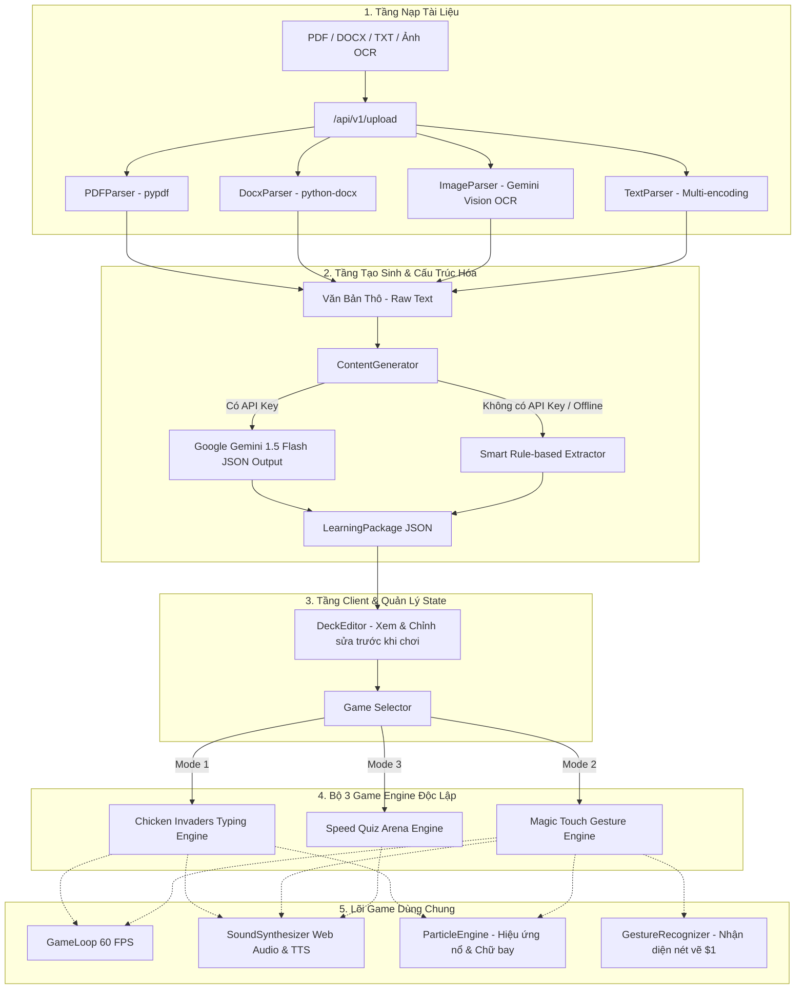

# 📘 TÀI LIỆU TOÀN DIỆN: GIẢI THÍCH CẤU TRÚC VÀ MÃ NGUỒN DỰ ÁN AI EDUPLAY

Tài liệu này được biên soạn dành cho lập trình viên nhằm cung cấp cái nhìn chi tiết từ tổng thể kiến trúc, luồng dữ liệu (Data Pipeline), đến vai trò và logic hoạt động của từng tệp mã nguồn (`.py`, `.ts`, `.tsx`, `.bat`) trong dự án.

---

## 📑 MỤC LỤC
1. [Kiến Trúc Tổng Thể & Luồng Dữ Liệu](#1-kiến-trúc-tổng-thể--luồng-dữ-liệu)
2. [Cây Thư Mục Toàn Diện](#2-cây-thư-mục-toàn-diện)
3. [Giải Thích Chi Tiết Phân Hệ Backend (Python / FastAPI)](#3-giải-thích-chi-tiết-phân-hệ-backend-python--fastapi)
   - [3.1. Cấu hình & Dữ liệu cốt lõi (Core & Models)](#31-cấu-hình--dữ-liệu-cốt-lõi-core--models)
   - [3.2. Bộ xử lý tài liệu đa định dạng (Parsers)](#32-bộ-xử-lý-tài-liệu-đa-định-dạng-parsers)
   - [3.3. Lõi AI Tạo Sinh & Heuristic (AI Engine)](#33-lõi-ai-tạo-sinh--heuristic-ai-engine)
   - [3.4. Tầng Giao Tiếp API (API Endpoints & Main)](#34-tầng-giao-tiếp-api-api-endpoints--main)
4. [Giải Thích Chi Tiết Phân Hệ Frontend (React + TypeScript + Canvas)](#4-giải-thích-chi-tiết-phân-hệ-frontend-react--typescript--canvas)
   - [4.1. Hợp đồng dữ liệu (Types & Data Contracts)](#41-hợp-đồng-dữ-liệu-types--data-contracts)
   - [4.2. Hạ tầng Game Engine dùng chung (Common Engine)](#42-hạ-tầng-game-engine-dùng-chung-common-engine)
   - [4.3. Game 1: Bắn Gà Luyện Gõ (Chicken Shooter)](#43-game-1-bắn-gà-luyện-gõ-chicken-shooter)
   - [4.4. Game 2: Phù Thủy Vẽ Nét (Magic Touch)](#44-game-2-phù-thủy-vẽ-nét-magic-touch)
   - [4.5. Game 3: Đấu Trường Trắc Nghiệm (Speed Quiz Arena)](#45-game-3-đấu-trường-trắc-nghiệm-speed-quiz-arena)
   - [4.6. Các Thành Phần Giao Diện (Components & Views)](#46-các-thành-phần-giao-diện-components--views)
5. [Hướng Dẫn Mở Rộng Dành Cho Lập Trình Viên](#5-hướng-dẫn-mở-rộng-dành-cho-lập-trình-viên)

---

## 1. Kiến Trúc Tổng Thể & Luồng Dữ Liệu

Dự án áp dụng nguyên lý **Separation of Concerns (SoC)**, phân tách rành mạch giữa:
1. **Document Ingestion**: Tiếp nhận tài liệu người dùng tải lên và chuẩn hóa thành Plain Text.
2. **AI Structuring Engine**: Sử dụng Prompt Engineering + Gemini JSON Schema (kèm Fallback Heuristic) để chuyển văn bản thô thành danh sách đối tượng học tập có cấu trúc (`VocabularyDeck` & `QuizDeck`).
3. **Interactive Game Engine**: Tách biệt thành các module Canvas 2D độc lập chạy ở tốc độ 60 FPS, không phụ thuộc vào thư viện bên ngoài quá cồng kềnh.



---

## 2. Cây Thư Mục Toàn Diện

```
m:\Game/
├── backend/                             # [BACKEND] Máy chủ xử lý tài liệu & AI
│   ├── app/
│   │   ├── core/
│   │   │   └── config.py                # Cấu hình biến môi trường, upload dir
│   │   ├── models/                      # Pydantic Data Models (Data Contract)
│   │   │   ├── vocabulary.py            # Model từ vựng, phiên âm, nét vẽ
│   │   │   ├── quiz.py                  # Model câu hỏi trắc nghiệm
│   │   │   └── document.py              # Model tài liệu và LearningPackage
│   │   ├── services/
│   │   │   ├── parsers/                 # Trích xuất đa định dạng file
│   │   │   │   ├── base_parser.py       # Lớp trừu tượng BaseParser
│   │   │   │   ├── pdf_parser.py        # Đọc file PDF (pypdf)
│   │   │   │   ├── docx_parser.py       # Đọc file DOCX (python-docx)
│   │   │   │   ├── txt_parser.py        # Đọc file TXT đa bảng mã
│   │   │   │   └── image_parser.py      # OCR ảnh với Gemini Vision
│   │   │   ├── ai/                      # Tích hợp AI Gemini
│   │   │   │   ├── gemini_client.py     # Gọi Gemini API với JSON response format
│   │   │   │   ├── prompt_templates.py  # Prompt mẫu sinh từ vựng & quiz
│   │   │   │   └── content_generator.py # Điều phối tạo dữ liệu học tập
│   │   │   └── sample_data.py           # Bộ dữ liệu mẫu có sẵn (HSK1, Tech English)
│   │   ├── api/v1/                      # Endpoints REST API
│   │   │   ├── upload.py                # Endpoint nạp và parse file
│   │   │   ├── generate.py              # Endpoint sinh game từ text
│   │   │   └── decks.py                 # Endpoint lấy và lưu bộ thẻ
│   │   └── main.py                      # Khởi tạo FastAPI, CORS, Router
│   └── requirements.txt                 # Danh sách thư viện Python
│
├── frontend/                            # [FRONTEND] Ứng dụng Web React + Canvas Games
│   ├── src/
│   │   ├── types/                       # Khai báo kiểu dữ liệu TypeScript
│   │   │   ├── learning_content.ts      # Types cho VocabularyItem, QuizItem, LearningPackage
│   │   │   └── game.ts                  # Types cho GameStats, GameState, Particle, Point2D
│   │   ├── games/                       # LÕI CÁC GAME ENGINE
│   │   │   ├── common/                  # Hạ tầng game dùng chung
│   │   │   │   ├── GameLoop.ts          # Vòng lặp animation delta-time chuẩn 60fps
│   │   │   │   ├── SoundSynthesizer.ts  # Web Audio API tạo SFX + TTS phát âm
│   │   │   │   ├── ParticleEngine.ts    # Hệ thống hạt, nổ, sóng xung kích, số điểm bay
│   │   │   │   └── GestureRecognizer.ts # Nhận diện nét vẽ hình học (8 loại nét)
│   │   │   ├── chicken-shooter/         # GAME 1: Bắn Gà Luyện Gõ
│   │   │   │   ├── ChickenEngine.ts     # Engine điều khiển chính (Wave, HP, Score)
│   │   │   │   ├── ChickenEntity.ts     # Thực thể gà neon có hoạt họa vỗ cánh
│   │   │   │   ├── PlayerSpaceship.ts   # Phi thuyền điều khiển của người chơi
│   │   │   │   ├── LaserBeam.ts         # Đạn laser plasma khóa mục tiêu
│   │   │   │   └── TypingController.ts  # Bộ bắt phím & lock-on target
│   │   │   ├── magic-touch/             # GAME 2: Phù Thủy Vẽ Nét
│   │   │   │   ├── MagicTouchEngine.ts  # Engine điều khiển game vẽ nét
│   │   │   │   ├── BalloonMonster.ts    # Quái vật treo bóng có cơ chế rơi tự do
│   │   │   │   └── DrawingCanvas.ts     # Bắt tọa độ chuột/cảm ứng & vẽ vệt sáng
│   │   │   └── quiz-arena/              # GAME 3: Đấu Trường Trắc Nghiệm
│   │   │       └── QuizEngine.ts        # Engine câu hỏi trắc nghiệm đếm ngược 10s
│   │   ├── components/                  # Các UI Components
│   │   │   ├── Navbar.tsx               # Thanh điều hướng trên cùng
│   │   │   ├── ApiKeyModal.tsx          # Hộp thoại cấu hình Gemini API Key
│   │   │   ├── game-shared/             # Components dùng trong các game
│   │   │   │   ├── ScoreHUD.tsx         # Thanh hiển thị điểm, combo, độ chính xác
│   │   │   │   ├── HealthBar.tsx        # Thanh hiển thị tim/máu (HP)
│   │   │   │   └── GameOverModal.tsx    # Bảng tổng kết chiến thắng / thua cuộc
│   │   │   └── upload/                  # Giao diện nạp & chỉnh sửa
│   │   │       ├── DocumentUpload.tsx   # Khu vực kéo thả file & phân tích
│   │   │       └── DeckEditor.tsx       # Bộ biên tập từ vựng, nét vẽ & câu hỏi
│   │   ├── views/                       # Các màn hình chính
│   │   │   ├── DashboardView.tsx        # Trang chủ & chọn chế độ chơi
│   │   │   ├── UploadStudioView.tsx     # Studio nạp và biên tập bài học
│   │   │   ├── ChickenShooterView.tsx   # Màn hình chơi Game Bắn Gà
│   │   │   ├── MagicTouchView.tsx       # Màn hình chơi Game Vẽ Nét Magic Touch
│   │   │   └── QuizArenaView.tsx        # Màn hình chơi Game Quiz Arena
│   │   ├── lib/
│   │   │   └── api.ts                   # Client kết nối REST API Backend
│   │   ├── App.tsx                      # Root component, quản lý State toàn cục
│   │   ├── main.tsx                     # Điểm gắn React DOM
│   │   └── index.css                    # Tailwind CSS & Keyframes animation
│   ├── package.json
│   ├── tsconfig.json
│   ├── vite.config.ts
│   └── tailwind.config.js
│
├── start_all.bat                        # Script khởi chạy đồng thời Backend + Frontend
├── run_backend.bat                      # Script chạy Backend FastAPI (Cổng 8000)
├── run_frontend.bat                     # Script chạy Frontend React (Cổng 3000)
└── README.md                            # Hướng dẫn sử dụng nhanh
```

---

## 3. Giải Thích Chi Tiết Phân Hệ Backend (Python / FastAPI)

### 3.1. Cấu hình & Dữ liệu cốt lõi (Core & Models)

#### 📄 `backend/app/core/config.py`
- **Vai trò**: Quản lý các biến môi trường và thiết lập hệ thống.
- **Nội dung chính**:
  - `GEMINI_API_KEY`: Đọc key từ `.env` hoặc biến môi trường máy chủ.
  - `UPLOAD_DIR`: Đường dẫn thư mục lưu tạm file khi người dùng upload (`backend/uploads`).
  - `ALLOWED_ORIGINS`: Danh sách nguồn được phép gọi API (CORS).

#### 📄 `backend/app/models/vocabulary.py`
- **Vai trò**: Định nghĩa khuôn mẫu Pydantic cho dữ liệu từ vựng.
- **Các trường dữ liệu quan trọng**:
  - `target_text`: Từ gốc / Chữ Hán (vd: "你好", "Algorithm").
  - `phonetic`: Phiên âm phát âm / Pinyin / IPA (vd: "nǐ hǎo").
  - `type_target`: Chuỗi ký tự chuẩn hóa không dấu dùng cho cơ chế gõ phím của Game Bắn Gà (vd: "nihao", "algorithm").
  - `meaning`: Nghĩa tiếng Việt ngắn gọn.
  - `stroke_gesture`: Kiểu nét vẽ tương ứng cho Game Magic Touch (`horizontal`, `vertical`, `slash`, `backslash`, `v_shape`, `caret`, `circle`, `lightning`).

#### 📄 `backend/app/models/quiz.py`
- **Vai trò**: Định nghĩa khuôn mẫu Pydantic cho câu hỏi trắc nghiệm.
- **Các trường**: `question`, `options` (4 lựa chọn A, B, C, D), `correct_index` (0-3), `explanation` (giải thích tại sao đúng), `points`.

#### 📄 `backend/app/models/document.py`
- **Vai trò**: Định nghĩa đối tượng kết quả phân tích file (`DocumentExtractResult`) và gói tài liệu hoàn chỉnh (`LearningPackage` bao gồm cả `VocabularyDeck` và `QuizDeck`).

---

### 3.2. Bộ xử lý tài liệu đa định dạng (Parsers)

#### 📄 `backend/app/services/parsers/base_parser.py`
- Khai báo lớp trừu tượng `BaseParser` với phương thức bắt buộc `parse(self, file_path: str) -> str`.

#### 📄 `backend/app/services/parsers/pdf_parser.py`
- Sử dụng thư viện `pypdf` (`PdfReader`) duyệt qua từng trang, trích xuất text và gộp lại với định dạng phân đoạn rõ ràng.

#### 📄 `backend/app/services/parsers/docx_parser.py`
- Sử dụng `python-docx` (`docx.Document`) duyệt qua các đoạn văn (`paragraphs`) và các bảng biểu (`tables`) để không bỏ sót từ vựng dạng bảng.

#### 📄 `backend/app/services/parsers/txt_parser.py`
- Hỗ trợ cơ chế tự động thử nhiều bảng mã (UTF-8, UTF-16, Latin-1, CP1252, GBK/GB2312) để đọc chính xác file text tiếng Trung hoặc tiếng Việt mà không bị lỗi font (mojibake).

#### 📄 `backend/app/services/parsers/image_parser.py`
- Mở ảnh bằng `Pillow` và gửi sang mô hình đa phương thức `Gemini 1.5 Flash` với prompt OCR giáo dục chuyên dụng, nhận diện cả chữ in, chữ viết tay và bảng từ vựng song ngữ.

---

### 3.3. Lõi AI Tạo Sinh & Heuristic (AI Engine)

#### 📄 `backend/app/services/ai/gemini_client.py`
- Khởi tạo client `google.generativeai`. Thiết lập `response_mime_type: "application/json"` để ép buộc mô hình trả về đúng chuẩn JSON, đồng thời tích hợp bộ làm sạch markdown (`strip ```json`).

#### 📄 `backend/app/services/ai/prompt_templates.py`
- Chứa 2 prompt khuôn mẫu:
  1. `VOCABULARY_EXTRACTION_PROMPT`: Yêu cầu AI trích xuất các từ quan trọng, sinh `phonetic`, chuẩn hóa `type_target` cho bàn phím, và phân bổ 8 loại `stroke_gesture` cho game vẽ.
  2. `QUIZ_GENERATION_PROMPT`: Yêu cầu AI tạo câu hỏi 4 lựa chọn có tính sư phạm cao, gài bẫy hợp lý và kèm giải thích chi tiết.

#### 📄 `backend/app/services/ai/content_generator.py`
- **Nhạc trưởng tạo sinh**:
  - Nếu người dùng có API Key (hoặc hệ thống có cấu hình), gọi `GeminiClient` để sinh dữ liệu chất lượng cao.
  - Nếu không có API Key hoặc mất kết nối mạng: Kích hoạt `_smart_rule_based_fallback()`. Phương thức này tự động phân tích dòng, dấu gạch nối, dấu hai chấm trong văn bản của người dùng để sinh ra bộ từ vựng và tạo các câu hỏi trắc nghiệm đảo phương án tự động, đảm bảo người dùng **luôn có game để chơi ngay lập tức**.

#### 📄 `backend/app/services/sample_data.py`
- Cung cấp sẵn 2 bộ bài học mẫu:
  1. *Tiếng Trung Giao Tiếp HSK 1* (你好, 谢谢, 再见, 苹果, 老师...).
  2. *English for Technology & AI* (Algorithm, Database, Framework, Neural, Compiler...).

---

### 3.4. Tầng Giao Tiếp API (API Endpoints & Main)

#### 📄 `backend/app/api/v1/upload.py`
- `POST /api/v1/upload`: Nhận file upload (`UploadFile`), kiểm tra phần mở rộng file, lưu vào thư mục tạm, điều hướng tới parser tương ứng, và tự động xóa file tạm sau khi trích xuất xong.

#### 📄 `backend/app/api/v1/generate.py`
- `POST /api/v1/generate`: Nhận `raw_text`, gọi `ContentGenerator` và trả về `LearningPackage`.

#### 📄 `backend/app/api/v1/decks.py`
- `GET /api/v1/decks`: Lấy danh sách các bộ bài học sẵn có.
- `POST /api/v1/decks`: Lưu một bộ bài học tùy chỉnh do người dùng tạo.

#### 📄 `backend/app/main.py`
- Khởi tạo FastAPI app, cấu hình CORS Middleware cho phép frontend kết nối và gắn các sub-router theo tiền tố `/api/v1`.

---

## 4. Giải Thích Chi Tiết Phân Hệ Frontend (React + TypeScript + Canvas)

### 4.1. Hợp đồng dữ liệu (Types & Data Contracts)

#### 📄 `frontend/src/types/learning_content.ts`
- Định nghĩa `StrokeGestureType` (8 loại nét: `horizontal`, `vertical`, `slash`, `backslash`, `v_shape`, `caret`, `circle`, `lightning`).
- Định nghĩa các interface: `VocabularyItem`, `VocabularyDeck`, `QuizItem`, `QuizDeck`, `LearningPackage`.

#### 📄 `frontend/src/types/game.ts`
- Định nghĩa trạng thái game `GameState` (`READY`, `PLAYING`, `PAUSED`, `GAMEOVER`, `VICTORY`).
- Định nghĩa `GameStats` (score, streak, maxStreak, wordsDefeated, accuracy).
- Định nghĩa `Particle` và `Point2D`.

---

### 4.2. Hạ tầng Game Engine dùng chung (Common Engine)

#### 📄 `frontend/src/games/common/GameLoop.ts`
- **Nhiệm vụ**: Cung cấp vòng lặp game ổn định 60 FPS dựa trên `requestAnimationFrame`.
- **Cơ chế**: Tính toán khoảng thời gian giữa 2 khung hình (`deltaTime = (currentTime - lastTime) / 1000`), giới hạn `Math.min(deltaTime, 0.1)` để tránh hiện tượng quái vật dịch chuyển tức thời khi người dùng chuyển tab trình duyệt.

#### 📄 `frontend/src/games/common/SoundSynthesizer.ts`
- **Nhiệm vụ**: Tạo hiệu ứng âm thanh bằng mã lệnh (procedural audio) thông qua **Web Audio API** mà không cần tải bất kỳ file mp3 nào:
  - `playLaser()`: Sóng răng cưa (sawtooth) tần số quét từ 880Hz xuống 110Hz.
  - `playExplosion()`: Sóng tam giác tần số thấp 160Hz xuống 30Hz với Gain giảm dần.
  - `playPop()`: Sóng sin tần số tăng nhanh 400Hz -> 900Hz tạo tiếng nổ bóng bay trong trẻo.
  - `playMagicSpell()`: Hợp âm rải 4 nốt (C5, E5, G5, C6).
  - `playCombo()`: Hợp âm hòa thanh A-major.
  - `speakText(text, lang)`: Tích hợp **Web Speech Synthesis API** (`SpeechSynthesisUtterance`) tự động phát âm chuẩn tiếng Trung (`zh-CN`) hoặc tiếng Anh (`en-US`) khi người chơi bắn trúng mục tiêu.

#### 📄 `frontend/src/games/common/ParticleEngine.ts`
- **Nhiệm vụ**: Quản lý hàng trăm hạt ánh sáng neon phát nổ, các vòng sóng xung kích (`shape: 'ring'`), và các đoạn chữ chiến đấu bay lên (`FloatingText` như `+100`, `COMBO x2!`, `-1 HP`).

#### 📄 `frontend/src/games/common/GestureRecognizer.ts`
- **Nhiệm vụ**: Nhận diện cử chỉ vẽ nét của người dùng dựa trên phân tích hình học và góc vector ($1-Recognizer approach):
  1. *Tính chiều dài đường đi (Path Length) và Bounding Box*.
  2. *Hình tròn (Circle)*: Điểm bắt đầu và kết thúc gần nhau (`directDist < pathLength * 0.35`).
  3. *Đường thẳng (Ngang, Sổ, Phẩy, Mác)*: Độ thẳng `directDist / pathLength > 0.78` kết hợp góc `atan2(dy, dx)`.
  4. *Nét phức hợp (Chữ V, Caret ^, Lightning ⚡)*: Tìm điểm cực trị Y (inflection point).

---

### 4.3. Game 1: Bắn Gà Luyện Gõ (Chicken Shooter)

#### 📄 `frontend/src/games/chicken-shooter/ChickenEntity.ts`
- Đại diện cho từng chú gà bay từ trên xuống.
- Vẽ bằng Canvas 2D với mào gà, mỏ cam, cánh vỗ theo hàm `sin(animTimer)`.
- Bên dưới chú gà có thẻ tag hiển thị Pinyin, nghĩa tiếng Việt và **từng ký tự cần gõ** được highlight màu xanh neon khi người chơi đã gõ đúng.

#### 📄 `frontend/src/games/chicken-shooter/PlayerSpaceship.ts`
- Phi thuyền chiến đấu neon của người chơi ở đáy màn hình.
- Tự động trượt mượt mà về tọa độ X của mục tiêu đang nhắm (`this.x += (targetX - x) * 12 * dt`).
- Có hiệu ứng giật lùi (`recoilOffset`) khi bắn và ngọn lửa phản lực đuôi tàu nhấp nháy.

#### 📄 `frontend/src/games/chicken-shooter/LaserBeam.ts`
- Đại diện cho tia đạn năng lượng plasma bắn từ phi thuyền hướng thẳng tới tọa độ của chú gà đang bị khóa.

#### 📄 `frontend/src/games/chicken-shooter/TypingController.ts`
- Quản lý logic gõ phím:
  - Khi chưa có mục tiêu: Tìm chú gà ở vị trí thấp nhất có chữ cái đầu trùng với phím vừa bấm và **khóa mục tiêu (lock-on)**.
  - Khi đã khóa mục tiêu: Người chơi phải tiếp tục gõ đúng các ký tự tiếp theo của từ đó.
  - Khi hoàn thành từ: Kích hoạt nổ quái, phát âm từ vựng TTS và giải phóng mục tiêu.

#### 📄 `frontend/src/games/chicken-shooter/ChickenEngine.ts`
- Vận hành vòng lặp game, quản lý sinh đàn gà (`spawnNextChicken`), trừ máu khi gà chạm đáy màn hình, tính toán điểm số combo, gọi `GameLoop` và `ParticleEngine`.

---

### 4.4. Game 2: Phù Thủy Vẽ Nét (Magic Touch)

#### 📄 `frontend/src/games/magic-touch/BalloonMonster.ts`
- Đại diện cho quái vật treo dưới quả bóng bay rực rỡ có in biểu tượng nét vẽ (`—`, `|`, `/`, `\`, `V`, `^`, `O`, `⚡`).
- Khi bóng bị phá (`pop()`): Kích hoạt cờ `isFalling = true`, quái vật rơi tự do xuống dưới theo gia tốc trọng lực `980 px/s²`.

#### 📄 `frontend/src/games/magic-touch/DrawingCanvas.ts`
- Lắng nghe các sự kiện con trỏ (`pointerdown`, `pointermove`, `pointerup`).
- Vẽ vệt sáng phép thuật phát sáng màu cyan và trắng ngay dưới đầu ngón tay/con chuột của người chơi.

#### 📄 `frontend/src/games/magic-touch/MagicTouchEngine.ts`
- Khi người chơi vẽ xong một nét: Gửi danh sách điểm sang `GestureRecognizer`.
- Nếu nhận diện khớp: Tìm tất cả quái vật có bóng mang nét vẽ đó, làm nổ bóng hàng loạt (combo nổ đa mục tiêu), cộng điểm và kích hoạt âm thanh phép thuật.

---

### 4.5. Game 3: Đấu Trường Trắc Nghiệm (Speed Quiz Arena)

#### 📄 `frontend/src/games/quiz-arena/QuizEngine.ts`
- Quản lý bộ câu hỏi trắc nghiệm, cơ chế đếm ngược 10 giây/câu (`setInterval`).
- Tính điểm thưởng theo thời gian còn lại (`timeBonus = timeLeft * 10`) và hệ số nhân chuỗi đúng liên tiếp (`comboMultiplier`).
- Kiểm tra đáp án và gửi kết quả giải thích về UI.

---

### 4.6. Các Thành Phần Giao Diện (Components & Views)

- 📄 `frontend/src/components/effects/VietnamStarCursor.tsx`: Con trỏ chuột tùy biến hình **Ngôi Sao Vàng Việt Nam** 5 cánh phát sáng rực rỡ, tự động phóng to khi rê qua nút bấm và để lại vệt sao lấp lánh (sparkle trail) mượt mà.
- 📄 `frontend/src/components/effects/DolphinCompanion.tsx`: Chú **Cá Heo Neon thông minh** bơi lội vòng quanh 4 góc màn hình, uốn lượn vây đuôi sinh động, nhào lộn 360 độ (barrel roll jump), nhả bọt nước phát sáng và bơi lại gần khi người dùng di chuột đến gần.
- 📄 `frontend/src/components/Navbar.tsx`: Thanh menu chuyển đổi giữa Dashboard, AI Studio, 3 chế độ game; nút bật/tắt âm thanh, nút bật/tắt Cá Heo & Chuột Sao VN (🐬⭐) và cấu hình API Key.
- 📄 `frontend/src/components/ApiKeyModal.tsx`: Hộp thoại lưu Gemini API Key vào `localStorage`.
- 📄 `frontend/src/components/game-shared/ScoreHUD.tsx`: Thanh HUD hiển thị Điểm số, Combo Streak, Độ chính xác và Số từ đã hạ gục.
- 📄 `frontend/src/components/game-shared/HealthBar.tsx`: Thanh hiển thị trái tim máu (HP) phát sáng.
- 📄 `frontend/src/components/game-shared/GameOverModal.tsx`: Hộp thoại khi Chiến thắng (Victory) hoặc Hết máu (Game Over) kèm thống kê chi tiết.
- 📄 `frontend/src/components/upload/DocumentUpload.tsx`: Vùng kéo thả file, hiển thị trạng thái phân tích và nút bấm gọi AI tạo game.
- 📄 `frontend/src/components/upload/DeckEditor.tsx`: Bộ công cụ biên tập bảng từ vựng, chỉnh sửa Pinyin, gán nét vẽ phép thuật, nghe thử giọng đọc và sửa câu hỏi quiz.
- 📄 `frontend/src/views/DashboardView.tsx`: Trang chủ với Hero Banner hiện đại và danh sách các game/bài học có sẵn.
- 📄 `frontend/src/views/UploadStudioView.tsx`: Màn hình tích hợp khu vực upload và bộ biên tập deck.
- 📄 `frontend/src/views/ChickenShooterView.tsx`: Container gắn kết Canvas và điều khiển Game Bắn Gà.
- 📄 `frontend/src/views/MagicTouchView.tsx`: Container gắn kết Canvas và điều khiển Game Magic Touch.
- 📄 `frontend/src/views/QuizArenaView.tsx`: Màn hình giao diện thẻ bài thi trắc nghiệm tốc độ cao.
- 📄 `frontend/src/App.tsx`: Điều phối State cấp cao nhất, lưu trữ danh sách Deck và chuyển đổi giữa các View.

---

## 5. Hướng Dẫn Mở Rộng Dành Cho Lập Trình Viên

### 5.1. Thêm một Mini-Game mới vào hệ thống
1. Tạo thư mục mới trong `frontend/src/games/ten-game-moi/` và viết class Engine (kế thừa `GameLoop`, `soundManager`, `ParticleEngine`).
2. Tạo View component tại `frontend/src/views/TenGameMoiView.tsx`.
3. Thêm tab định danh vào `ActiveTab` trong `frontend/src/components/Navbar.tsx`.
4. Thêm case render trong `frontend/src/App.tsx`.

### 5.2. Thêm một định dạng Parser mới
1. Tạo file parser mới trong `backend/app/services/parsers/ten_parser.py` kế thừa `BaseParser`.
2. Khai báo parser trong `backend/app/api/v1/upload.py` và bổ sung đuôi file vào danh sách `allowed_exts`.

### 5.3. Kết nối Cơ Sở Dữ Liệu Thực Tế (PostgreSQL / MongoDB / Supabase)
1. Trong `backend/app/api/v1/decks.py`, thay thế `SAVED_PACKAGES` (in-memory dictionary) bằng các câu lệnh truy vấn ORM (SQLAlchemy, Prisma, hoặc Motor/PyMongo).
2. Lưu trữ trường `LearningPackage` dưới dạng bảng quan hệ hoặc Document JSONB.
